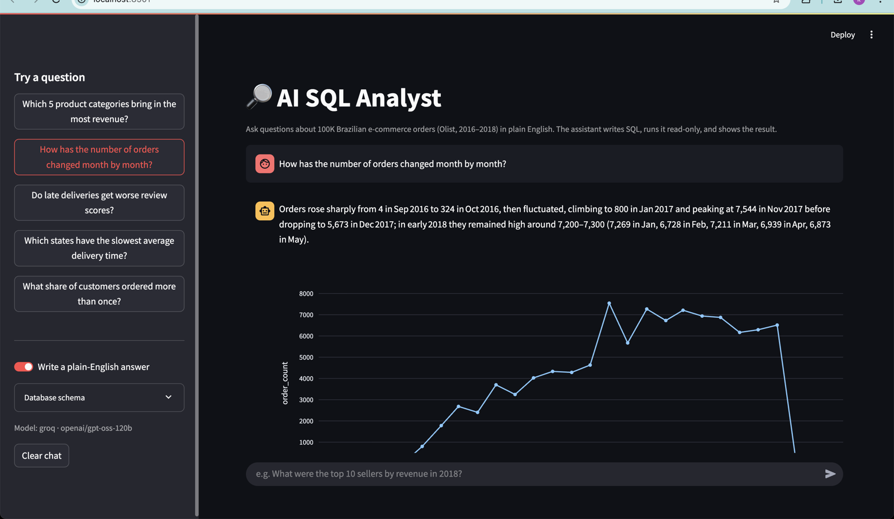
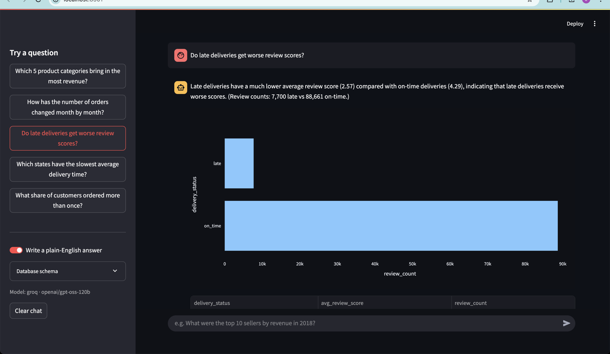

# AI SQL Analyst

Ask business questions about **100K real e-commerce orders in plain English**. The assistant
writes the SQL with an LLM (gpt-oss-120b on Groq's free tier, or Gemini / OpenAI), checks it is safe, runs it **read-only**, fixes its own mistakes,
and returns a table, a chart and a one-line answer.

Accuracy is **measured, not assumed**: a 50-question benchmark with hand-written gold SQL
scores every answer by comparing query results.

**Stack:** Python · SQLite · SQL · LLM APIs (Groq / Gemini / OpenAI) · Streamlit · Plotly · pytest

---

## How it works

```
 "Which states have the slowest deliveries?"
                 │
                 ▼
  ┌───────────────────────────────┐
  │ Prompt = schema + example      │  db.describe_schema(): tables, columns,
  │ values + business notes        │  row counts, sample values, join hints
  └───────────────────────────────┘
                 │  LLM (gpt-oss-120b on Groq, Gemini or OpenAI)
                 ▼
  ┌───────────────────────────────┐
  │ Safety guard                   │  only ONE SELECT/WITH · blocks DROP/DELETE/
  │                                │  UPDATE/PRAGMA/ATTACH… · 1,000-row limit
  └───────────────────────────────┘
                 ▼
  ┌───────────────────────────────┐
  │ Run on a READ-ONLY connection  │  SQLite opened with mode=ro + query_only
  │ with a 10-second timeout       │
  └───────────────────────────────┘
          │ error?  ──► send the error back to the model, retry once (self-correction)
          ▼
   table + auto chart + plain-English summary  (Streamlit chat app)
```

## Results

Measured on the real Olist database (99,441 orders) with `python eval/run_eval.py`:

| Metric | Value |
|---|---|
| Benchmark questions | 50 (16 easy · 18 medium · 16 hard) |
| **Overall execution accuracy** | **94.0 %** (47 / 50) |
| Easy / Medium / Hard | 100 % / 83.3 % / 100 % |
| Avg. model + query time per question | 0.88 s |
| Tokens used for the full benchmark | 67,353 |
| Model | `openai/gpt-oss-120b` on Groq (free tier) |

Per-question results, generated SQL and gold SQL: [`eval/results/eval_api.csv`](eval/results/eval_api.csv).

## Demo

**"How has the number of orders changed month by month?"** — the assistant writes the SQL,
draws the trend and summarises it:



**"Do late deliveries get worse review scores?"** — late deliveries average **2.57 stars**
vs **4.29** for on-time deliveries (7,700 vs 88,661 reviews):



## Safety

Two independent layers, so a bad query can never change the data:
1. **Validator** (`safety.py`): accepts a single `SELECT`/`WITH` statement only; rejects
   `DROP`, `DELETE`, `UPDATE`, `INSERT`, `ALTER`, `PRAGMA`, `ATTACH` and multiple statements;
   wraps every query in a 1,000-row limit.
2. **Read-only database connection** (`db.connect_readonly`): even a query that slipped past
   the validator fails on write. Tested in `tests/test_engine.py`.

## Evaluation method

`eval/questions.py` holds 50 questions with gold SQL, from simple counts to window functions
(month-over-month growth, best category per state). `eval/run_eval.py` runs each question
through the assistant and marks it correct when the result matches the gold result: same row
count and every gold column matched by value (rounded, order-insensitive). Column names may
differ — the numbers must be right.

```bash
python eval/run_eval.py --llm gold     # sanity check: benchmark itself scores 100%
python eval/run_eval.py                # real run with the key in .env (Groq, Gemini or OpenAI)
python eval/run_eval.py --sleep 6      # pause between questions to stay under free-tier rate limits
```

## Setup

```bash
git clone https://github.com/<your-username>/ai-sql-analyst.git
cd ai-sql-analyst
pip install -r requirements.txt

# 1. data: download https://www.kaggle.com/datasets/olistbr/brazilian-ecommerce and unzip
python scripts/build_db.py --csv-dir ~/Downloads/olist

# 2. API key: create .env (never commit it)
#    free Groq key: https://console.groq.com/keys  (Gemini or OpenAI keys also work)
cp .env.example .env        # then paste your key into .env

# 3. run
streamlit run app/streamlit_app.py
python eval/run_eval.py
pytest -q
```

## Project structure

```
ai-sql-analyst/
├── app/streamlit_app.py      # chat UI: answer, chart, table, SQL, CSV download
├── src/aisql/
│   ├── db.py                 # build SQLite from CSVs, read-only connection, schema text
│   ├── safety.py             # SQL validator + row limit
│   ├── llm.py                # Groq / Gemini / OpenAI backends with rate-limit retries
│   └── engine.py             # question → SQL → safe run → self-correction → answer
├── eval/
│   ├── questions.py          # 50 benchmark questions + gold SQL
│   └── run_eval.py           # execution-accuracy scorer
├── scripts/
│   ├── build_db.py           # load the Kaggle CSVs
│   └── make_sample_csvs.py   # synthetic data for tests only
└── tests/test_engine.py      # safety, self-correction, scorer tests (no API needed)
```

## Dataset

[Brazilian E-Commerce Public Dataset by Olist](https://www.kaggle.com/datasets/olistbr/brazilian-ecommerce):
~99K orders, 2016–2018, with customers, sellers, products, items, payments and reviews.
